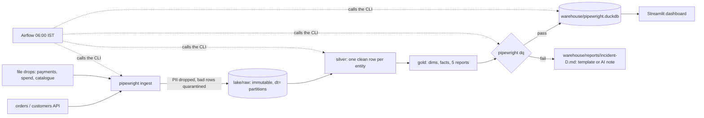

# Design: Pipewright v1.0

Status: accepted · Implements `spec/requirements.md` · Decisions: `spec/adr/0001-0005`

## 1. Architecture

- **Ingestion** (`pipewright ingest`): loads one source for one business date into the lake. Guarantee: the
  partition for (source, D) holds exactly what the source delivered for D, without PII, or the step fails.
- **Lake** (bronze): files as received, `lake/raw/<source>/dt=D/`, plus `lake/_manifests/<source>/D.json` (counts,
  sha256, contract version) and `lake/_state/<source>.json` (the last loaded date). Never edited, only replaced
  whole when a day is re-run.
- **Transform** (`pipewright transform`): the track (dbt or PySpark) builds silver and gold for run date D from
  every partition `dt <= D` into the **build file** `warehouse/pipewright_build.duckdb`. Guarantee: gold has
  exactly the contract's columns and types.
- **Checks** (`pipewright dq`): the contract's checks (plus dbt's test results on the SQL track) on the build.
  Guarantee: the verdict is recorded in the build (`ops.build_info.publishable`) and in `warehouse/reports/dq-D.json`.
- **Publish** (`pipewright publish`): one atomic rename of the build onto `warehouse/pipewright.duckdb`, only if
  publishable. Guarantee: readers see a complete, checked build or the previous one.
- **Dashboard**: reads only the published file, read-only, and shows its business date.

## 2. Layers and their contracts
| Layer | Where | Grain | Who writes it | Who may read it | Immutable? |
|---|---|---|---|---|---|
| bronze | `lake/raw/<source>/dt=D/` | one file per delivery | ingestion only | silver models only | yes (a re-run replaces a whole partition) |
| silver | build file, schema `silver` | one row per entity (latest order version, one payment event, ...) | the track | gold models only | rebuilt every run |
| gold | build file, schema `gold` | facts, dims, the 5 reports (contract columns) | the track | checks; after publish, the dashboard | rebuilt every run |
| ops | build file, schema `ops` | build info, run metadata | runner, checks | publish gate, dashboard | per build |
| published | `warehouse/pipewright.duckdb` | = gold + ops of the last good build | publish (rename) | dashboard, analysts | replaced atomically |

## 3. Ingestion
- **API sources** (orders, customers): window for D = `[D 00:00 IST, D+1 00:00 IST)` on `updated_at` (half-open),
  `limit` 200 (configurable), follow `next_cursor` until null. Records are stored as JSONL with their original
  strings (times, cities): parsing happens in silver, so a parsing fix replays over history.
- **File sources**: `drops/<source>/<pattern with D>`; validated (required columns, parseable) and copied
  byte-for-byte. `pipewright check-drops D` exits 3 when a file is missing, so the scheduler can wait and retry.
- **HTTP**: timeout 10 s, up to 5 attempts, exponential backoff with jitter (0.5 s doubling, max 8 s), honouring
  `Retry-After`; 401 and other 4xx are not retried.
- **Idempotency**: a partition is written to `dt=D.tmp-*` and renamed over `dt=D`; the manifest is written last.
  Re-running D replaces D; it never appends.
- **Quarantine**: a record missing a required field goes to `lake/quarantine/<source>/D.jsonl` with the reason; the
  manifest counts it. **PII**: `pii_drop` fields are removed in memory before anything is written.

## 4. Transformations
Both tracks implement `contract/transform-spec.md` and must produce identical gold tables:

| Model | Rule | SQL · dbt | Python · PySpark |
|---|---|---|---|
| parsing | §2 | macros `utc_timestamp`, `ist_date`, `to_paise` | `parsing.py` |
| `stg_orders`, `stg_order_items`, `stg_customers`, `stg_payments`, `stg_marketing_spend`, `stg_products` | §3 | `models/staging/*.sql` | `staging.py` |
| `dim_products`, `fct_order_items`, `fct_orders`, `dim_customers` | §4 | `models/gold/*.sql` | `gold.py` |
| the five `mart_*` reports | §5 | `models/gold/mart_*.sql` | `gold.py` |
| contract enforcement | gold columns | `contract: {enforced: true}` | `pipeline.enforce()` |

PySpark writes gold as Parquet and registers it in the build file, so checks, publish and dashboard are shared.

## 5. Quality and the publish gate
- **At build time:** dbt model contracts / `enforce()` (column names, types, order); dbt generic, singular and unit
  tests on the SQL track (Phase 4).
- **Before publishing:** the contract's checks (`row_count_min/max`, `accepted_values`, `relationship`, `max_share`,
  `expression`, `reconcile`) with severities. Only aggregates are recorded (counts, unexpected *values* that match
  a safe pattern), never rows.
- **Gate:** any failing `error` check → `publishable = false` → `dq` exits 1 with an incident report, `publish` refuses
  (exit 1); the dashboard keeps the last good business date. `warn` checks are published and reported.

## 6. Orchestration and schedule
Airflow 3 DAG `pipewright_daily`, `CronTriggerTimetable("30 0 * * *", UTC)` = 06:00 IST, business date = the IST day
before, `max_active_runs=1`, no catch-up. Tasks: `check_drops` (exit 3 → retried every 15 min for up to 3 h) →
`ingest_<source>` ×5 (retries with backoff) → `transform` → `dq` (never retried: a failed check is not flaky) →
`publish`. Every task is a `BashOperator` calling the `pipewright` CLI in its own virtualenv, so the same commands
run in CI, in tests, in Docker and on a laptop without Airflow (`pipewright run`).

## 7. Tools and footprint
| Old design | Decision | Why | RAM |
|---|---|---|---|
| Airbyte | **replaced** by the `pipewright` ingestion package (stdlib + DuckDB) | ADR-0002: Airbyte alone needs several GB and many containers; the ideas (windows, cursors, state, retries, idempotent writes, PII at the door, manifests) are taught in a few hundred tested lines | ~50 MB |
| Delta Lake + Spark cluster | **replaced** by lake files + a DuckDB warehouse file; **PySpark kept as a track** in local mode | ADR-0001: Delta needs jars fetched at runtime (breaks offline) and a JVM for every reader; DuckDB reads the same files in-process | DuckDB in-process; Spark driver 1 GB |
| dbt | **kept**: dbt-core 1.12 + dbt-duckdb 1.11 | models, tests, unit tests, contracts, incremental models (v1.1) | ~300 MB per run |
| Airflow | **kept**: Airflow 3.3 standalone, Postgres metadata DB, `BashOperator` → CLI | ADR-0005 | ~1.5-2 GB (limit 3 GB) |
| Metabase | **replaced** by a Streamlit dashboard | Metabase is a ~1.5 GB JVM and needs a third-party DuckDB driver; Streamlit is ~200 MB, code-reviewed, versioned and testable in CI | ~200 MB |
| Postgres as a source | **changed**: Postgres is Airflow's metadata DB only | the sources are an API and file drops, like most SaaS sources | ~60 MB |

Budget with everything up (source, Postgres, Airflow, dashboard, one pipeline run): about 5 GB at worst (the
compose file caps Airflow at 3 GB and the PySpark container at 2 GB), under the 6 GB target; with the pipeline profile
but no Airflow about 3 GB; without Docker (`make run`), under 1.5 GB. All versions are pinned (`requirements*.txt`, the Airflow
constraints file, Docker base images), and CI uses the same versions as the laptop.

## 8. Risks
| Risk | Mitigation |
|---|---|
| The two tracks drift apart | parity of every gold table on the fixture (tests) and the full history (CI) |
| A source changes its schema silently | required fields at ingestion; `accepted_values` checks block publishing; contract versioning (v1.1) |
| A late file | `check-drops` exit 3 + retries; the gate keeps the last good day; freshness monitoring (v1.1) |
| Spark's or the OS's time zone changes dates | offsets parsed by hand; session time zone UTC; tests at the IST midnight boundary |
| A wrong number that passes all checks | reconciliation checks, golden tables, hand-checked fixture |
